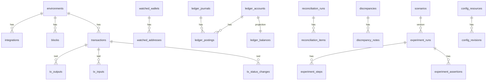

# Data model

All tables live in the `public` schema of a single PostgreSQL database. Every row that belongs to a sandbox
carries `environment_id`, and identities include it: a transaction is `(environment_id, txid)`, an output is
`(environment_id, txid, vout)`.

## Constraints that carry guarantees

| Guarantee | Mechanism |
|---|---|
| One best block per height | Partial unique index `blocks_one_best_block_per_height (environment_id, height) WHERE in_best_chain` |
| Only regtest | `CHECK (network = 'regtest')` on `environments`, plus JSON Schema `const` and a runtime chain check |
| Journal balanced per asset, at least two postings | Deferrable constraint triggers `ledger_postings_balanced` and `ledger_journals_have_postings` (checked at the end of each posting with `SET CONSTRAINTS ... IMMEDIATE`) |
| Postings reference accounts of the same environment and asset | Composite foreign keys `(account_id, environment_id, asset)` and `(journal_id, environment_id)` |
| Posted entries are immutable | `BEFORE UPDATE OR DELETE` triggers raising `integrity_constraint_violation` on journals and postings |
| Balance projection equals history | Balances are maintained only by the `AFTER INSERT` posting trigger; direct writes are rejected; `CHECK` ties `balance` to `debit_total` and `credit_total` |
| Restricted accounts never go negative | `CHECK (NOT restricted OR balance >= 0)` evaluated against the row version produced under the row lock |
| An operation entry is applied once | Unique `(environment_id, operation_id, entry_kind)` on journals and `(environment_id, scope, key)` on idempotency records with a parameter fingerprint |
| A journal is compensated at most once | Unique index on `reverses_journal_id` |
| Events are append-only and ordered by commit | Trigger forbidding updates and deletes; `pg_advisory_xact_lock` around appends so `seq` follows commit order |
| One active discrepancy per fingerprint | Partial unique index on `(environment_id, fingerprint) WHERE state IN ('open','investigating')` |
| Audit is append-only | Trigger forbidding updates and deletes |

## Indexes

Indexes follow the queries the UI and workers issue: chain tip lookup `(environment_id, in_best_chain, height)`,
transaction lists `(environment_id, status)` and `(environment_id, first_seen_at)`, address lookups
`(environment_id, address)`, spend detection `(environment_id, prev_txid, prev_vout)`, event streams
`(environment_id, event_type, seq)` and `(environment_id, aggregate_type, aggregate_id, seq)`, journals by
operation and by `posted_at`.

## Isolation and locking

- Default isolation is READ COMMITTED. Balance updates rely on row locks taken by `UPDATE`, which re-reads the
  latest committed row, so concurrent withdrawals serialize on the account row and the `CHECK` sees the real
  balance.
- Postings in a journal are inserted ordered by `account_id` so concurrent journals acquire balance row locks
  in the same order. Deadlocks and serialization failures are retried by `Repo.transact_with_retry/2` with
  exponential backoff and jitter.
- Chain sync serializes per environment with `pg_advisory_xact_lock(hashtext('chain:' || environment_id))` and
  re-checks the local tip before writing (optimistic check against concurrent sync).
- Configuration apply serializes per resource with an advisory lock and checks the expected revision.

## Retention and backups

Node observations, Oban jobs (pruned after 7 days) and webhook receipts grow over time; observations can be
pruned safely because they are diagnostics. Ledger, events and audit are never pruned by the application.
Back up with `pg_dump` (see [database recovery](../runbooks/database-recovery.md)). Partitioning, sharding and
read replicas are intentionally not used until a measured need exists.

## Migrations

Migrations are versioned in `apps/api/priv/repo/migrations` and run by a dedicated one-shot process (`migrate`
service in Compose, a Job in Helm). Ecto takes a database lock, so concurrent attempts are serialized. Future
schema changes follow expand and contract: add nullable columns, backfill, switch reads, then drop.
