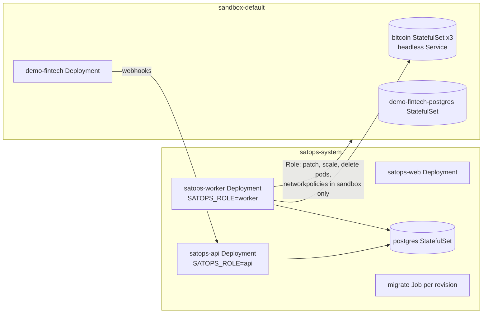

# Deployment

## Docker Compose (reference sandbox)

| Service | Image | Networks | Notes |
|---|---|---|---|
| postgres | postgres:17 | data (internal) | Creates `satops` and `demo_fintech` databases with separate roles |
| bitcoin-0, bitcoin-1 | bitcoin/bitcoin:29.0 | sandbox (internal) | `regtest=1`, `connect=` only to each other, no DNS seeds, txindex, ZeroMQ `sequence` |
| migrate | satops-api | data | One-shot `SatOps.Release.migrate()` before the API starts |
| api | satops-api | data, sandbox, edge | `SATOPS_ROLE=all` |
| demo-fintech | satops-demo-fintech | data, sandbox | Own database, own credentials, signed webhooks to the API |
| web | satops-web (nginx) | edge | Serves the SPA and proxies `/api`, `/graphql`, `/socket`; the only published port, bound to `127.0.0.1` by default |
| prometheus, grafana | profile `observability` | edge | Grafana bound to `127.0.0.1:8471` |

`data` and `sandbox` are `internal: true` networks: Bitcoin nodes and the demo fintech have no route to the
internet, and nothing outside Docker can reach them. Every service has CPU and memory limits. Compose never
mounts the Docker socket and does not touch other containers on the host.

Upgrade: `git pull && docker compose up -d --build`. Migrations run before the API starts.

## Kubernetes (Helm)

`deploy/helm/satops` installs into a release namespace (for example `satops-system`) plus a sandbox namespace:



- API and workers run the same image; scale them independently with `api.replicas` and `worker.replicas`.
- Migrations run in a Job named after the release revision; Ecto's migration lock serializes concurrent runs.
- The API service account does not mount a token. The worker service account is bound to a namespaced Role in
  the sandbox only (no cluster-admin, no namespace creation at runtime). Namespaces and quotas are created by
  whoever installs the chart, which is the privileged provisioner.
- The sandbox namespace has a ResourceQuota, a LimitRange and default-deny NetworkPolicies with explicit
  allowances (intra-sandbox, DNS, SatOps pods in, demo fintech webhooks out to the API).
- `SATOPS_RUNTIME=kubernetes` enables the `kubernetes.*` experiment actions. They refuse any namespace that is
  not in `SATOPS_K8S_SANDBOX_NAMESPACES` and does not start with `sandbox-`.

```bash
helm install satops deploy/helm/satops -n satops-system --create-namespace \
  --set secrets.secretKeyBase=$(openssl rand -base64 48) --set secrets.satopsSecretKey=$(openssl rand -base64 32) \
  --set secrets.postgresPassword=... --set secrets.satopsDbPassword=... --set secrets.demoFintechDbPassword=... \
  --set secrets.bitcoinRpcPassword=... --set secrets.demoFintechApiToken=... --set secrets.demoFintechWebhookSecret=...
```

Or reference an existing Secret with `existingSecret`.

## Home server: K3s in a dedicated VM

Recommended: a KVM/QEMU VM with 6 vCPUs, 12 GB RAM and 60 GB disk, no GPU passthrough, on a dedicated or
NAT network. Inside the VM install K3s (it ships Flannel; NetworkPolicies are enforced by K3s's embedded
network policy controller). Import the images (`k3s ctr images import`) or push them to a registry, then
install the chart. Nothing in this repository changes the host, its firewall or existing Docker services;
any script that does so must be reviewed and run by the administrator.

For development, `k3d cluster create satops --agents 1` gives a disposable cluster on Docker.

## What is and is not highly available

Tolerated: a crashed process (supervisor restart), a crashed worker or pod (Oban Lifeline rescues jobs,
leases expire), an unavailable integration (backoff and incomplete runs instead of false success), an
application restart (state is in PostgreSQL), a stopped Bitcoin node (failover to another reachable node).

Single points of failure in the reference installation: the physical server, its storage, the single
PostgreSQL instance, power and the host's connectivity. Several pods on one machine are not high availability.
