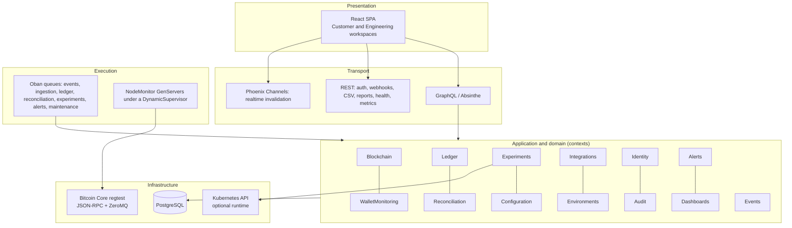

# Architecture overview

SatOps is a **modular monolith**: one Elixir/OTP application, one PostgreSQL database, one React
application. Modules are Phoenix contexts with small public APIs. The same release runs as API, worker or both
(`SATOPS_ROLE`), so API and workers scale separately without becoming separate services.

## Main flows

**Ingestion.** A `NodeMonitor` per Bitcoin node polls health over RPC and subscribes to the ZeroMQ `sequence`
topic. Notifications only *trigger* work: they enqueue a unique `SyncChain` job per environment. `SyncChain`
picks a reference node (most accumulated work among reachable regtest nodes), finds the common ancestor with
the stored best chain, disconnects and connects blocks in one transaction, updates transactions, outputs and
inputs, and appends durable events. Mempool is reconciled after the chain is caught up.

**Financial effects.** The `ledger.chain` consumer reads transaction and block events and, for outputs paying
monitored addresses with an account reference, evaluates a pure decision function (`Deposits.decide/5`) over
the *current* transaction state. Journals are produced by versioned pure rules and posted in a single
transaction guarded by database triggers.

**Reconciliation.** A run collects sources (native ledger, financial integrations), derives facts from the
observed chain, and executes the pure `Engine.run/3`. Results, discrepancies and the run summary are
persisted together with the reference tip and source watermarks.

**Experiments.** A run is a row with steps. `StepWorker` acquires a database lease, moves the run through its
state machine, executes whitelisted actions with timeouts, records checkpoints, evaluates assertions and
writes a report. After a crash, the step that was running is recovered according to the action's
idempotency class.

**Configuration.** Forms and YAML edit the same canonical document, validated by the JSON Schemas in
`packages/config-schemas` on both sides and authoritatively on the backend. Apply stores a revision with
optimistic concurrency and a reconciliation loop converges observed state to the desired revision.

## Why this shape

- One deployable keeps transactions local: a posting, its idempotency record, its balance projection and its
  event commit together. See [ADR 0001](../adr/0001-modular-monolith.md).
- PostgreSQL already provides durable queues (Oban), advisory locks, constraint triggers and MVCC. No Kafka,
  RabbitMQ or Redis is needed at this scale. See [ADR 0002](../adr/0002-postgresql-source-of-truth.md).
- OTP supervises connections and short-lived coordination; it never holds the only copy of state. See
  [ADR 0007](../adr/0007-otp-and-durable-jobs.md).
