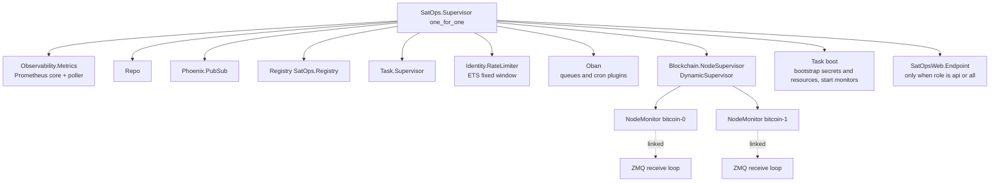

# Supervision tree

| Process | Why it is a process | What it must not do |
|---|---|---|
| NodeMonitor (GenServer) | Owns a connection lifecycle: periodic health checks, backoff, the ZeroMQ subscriber and per-topic sequence tracking | Hold chain state. It only records observations and enqueues durable sync jobs. |
| ZMQ loop (linked process) | Blocking `recv` on a chumak socket | Survive the monitor. If it dies the monitor traps the exit and reconnects with backoff. |
| RateLimiter (GenServer + ETS) | Periodic sweep of counters | Be shared across replicas. Limits are per node. |
| Oban | Durable work, retries, cron | Replace domain idempotency. |
| Runner | Plain functions executed inside an Oban job | Keep experiment state in memory. |

The node supervisor uses `max_restarts: 20` in 60 seconds and monitors keep failures inside the process
(an unreachable node is a state, not a crash), which avoids restart storms. A failing node never affects the
others: each monitor is an independent child.

`Registry` is used only to find local monitors by integration id. Exclusivity across replicas comes from
PostgreSQL: unique Oban jobs, `FOR UPDATE` on consumer checkpoints, advisory locks and experiment leases.
BEAM clustering is not required and not used.
