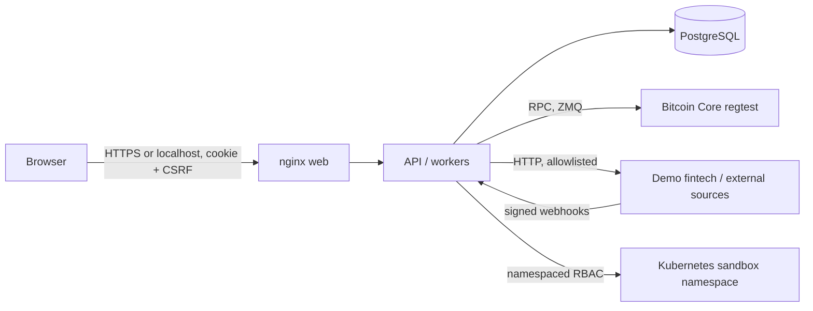

# Threat model

## Assets

Synthetic financial records (ledger, reconciliation evidence), integration credentials (encrypted secrets),
user accounts and sessions, audit trail, and the host that runs the sandbox.

## Trust boundaries

| Boundary | Threats | Mitigations |
|---|---|---|
| Browser to API | Credential stuffing, session theft, CSRF, XSS | Argon2, login rate limit, generic errors, HttpOnly SameSite=Strict cookies, CSRF header checked against the session, CSP and security headers, React escaping, no user supplied HTML or scripts (dashboards are registered widgets only) |
| API authorization | Privilege escalation, cross-environment access | Permission checked on every GraphQL field with the environment argument; effective role is the lower of global role and membership |
| API to integrations | SSRF to metadata services or the host | Host allowlist, DNS resolution checked against link-local and metadata ranges, no redirects, timeouts |
| Webhooks | Forgery, replay | HMAC-SHA256 over timestamp and body, tolerance window, unique delivery ids |
| Configuration and scenarios | Code execution, resource exhaustion | JSON Schema validation, whitelisted actions only (no shell, code or manifests), YAML limits (size, depth, nodes, no anchors or custom tags) |
| Secrets | Leakage via exports, logs or reports | AES-256-GCM at rest, referenced by name, never returned by the API, redaction in audit, logs and reports |
| Experiments | Damage outside the sandbox | Regtest enforced in schema, configuration and at connection time; Kubernetes actions restricted to allowlisted `sandbox-*` namespaces through a namespaced Role; Compose runtime never gets the Docker socket |
| Ledger | Tampering, accidental corruption | Immutability triggers, balance projections writable only by triggers, compensating entries require administrators and a reason, audit entries |

## Known limitations

- The audit log is append-only by database trigger. A database superuser can still alter it; it is **not**
  cryptographically tamper evident.
- Rate limiting is per API node (ETS); multiple replicas multiply the limit.
- TLS termination is expected to be provided by the deployment (Tailscale, an ingress or a reverse proxy).
  Set `SATOPS_COOKIE_SECURE=true` when served over HTTPS.
- Watched addresses and descriptors reveal financial activity; they are treated as sensitive but not
  encrypted at rest.
- The demo fintech intentionally misbehaves when fault modes are enabled; never expose it outside the sandbox.
